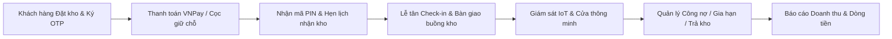

# 📦 Boxora — Hệ Thống Quản Lý & Cho Thuê Kho Tự Quản Thông Minh (Smart Self-Storage)

> **Boxora** là nền tảng số hóa toàn diện quy trình cho thuê, vận hành và quản lý chuỗi kho tự quản thông minh (Self-Storage Facility Rental System). Dự án tích hợp đầy đủ quy trình từ tìm kiếm, giữ chỗ trực tuyến, hợp đồng điện tử ký số qua OTP, thanh toán trực tuyến đa kênh, quản lý mặt bằng sơ đồ kho tương tác, bàn giao check-in tại cơ sở, xử lý công nợ và niêm phong kho quá hạn, phân ca trực nhân sự, đến phân tích doanh thu và dòng tiền điều hành cấp cao.

---

## 📑 Mục Lục

1. [Giới Thiệu & Điểm Nổi Bật](#1-giới-thiệu--điểm-nổi-bật)
2. [Kiến Trúc & Công Nghệ](#2-kiến-trúc--công-nghệ)
3. [Phân Quyền & Tài Khoản Thử Nghiệm](#3-phân-quyền--tài-khoản-thử-nghiệm)
4. [Yêu Cầu Môi Trường (Prerequisites)](#4-yêu-cầu-môi-trường-prerequisites)
5. [Hướng Dẫn Cài Đặt & Khởi Chạy Nhanh](#5-hướng-dẫn-cài-đặt--khởi-chạy-nhanh)
6. [Cấu Hình Biến Môi Trường (.env)](#6-cấu-hình-biến-môi-trường-env)
7. [Hướng Dẫn Vận Hành & Sử Dụng Theo Từng Vai Trò](#7-hướng-dẫn-vận-hành--sử-dụng-theo-từng-vai-trò)
8. [Kiểm Thử & Đảm Bảo Chất Lượng (Quality Assurance)](#8-kiểm-thử--đảm-bảo-chất-lượng-quality-assurance)
9. [Chính Sách Bảo Mật & An Toàn Dữ Liệu](#9-chính-sách-bảo-mật--an-toàn-dữ-liệu)
10. [Xử Lý Sự Cố Thường Gặp (Troubleshooting / FAQ)](#10-xử-lý-sự-cố-thường-gặp-troubleshooting--faq)

---

## 1. Giới Thiệu & Điểm Nổi Bật



- **Quy trình đặt kho tự động (Online Booking & E-Contract)**:
  - Tìm kiếm buồng kho theo cơ sở, kích thước (S/M/L), thể tích khối $m^3$, tùy chọn phòng máy lạnh (AC).
  - Khóa giữ chỗ tạm thời (Soft-lock 1 giờ) chống trùng đơn.
  - Ký hợp đồng điện tử pháp lý qua **mã OTP 6 số gửi về Email** (hoặc vẽ chữ ký trực tiếp / DocuSeal).
- **Thanh toán đa kênh linh hoạt**:
  - Tích hợp cổng thanh toán **VNPay Sandbox** (thẻ ATM nội địa NCB, quét mã QR).
  - Hỗ trợ chuyển khoản ngân hàng, tiền mặt tại quầy và **khấu trừ tự động từ tiền cọc (Deposit Deduction)** khi phát sinh phụ phí.
- **Sơ đồ mặt bằng tương tác thời gian thực (Interactive Floorplan)**:
  - Trực quan hóa tầng (Basement, 1st Floor,...) và phân khu chức năng (Zones).
  - Hiển thị trạng thái buồng kho trực quan: Trống (Available), Đang thuê (Occupied), Chờ bàn giao (Pending), Bảo trì (Maintenance), Nợ cước (Overdue), Niêm phong (Sealed).
- **Quy trình xử lý nợ cước & Niêm phong kho 3 cấp độ (Overdue & Asset Sealing)**:
  - Tự động quét và tính lũy tiến tiền phạt quá hạn theo chính sách cơ sở.
  - Tự động thu hồi mã PIN điện tử, khóa quyền ra vào khi vượt quá thời gian ân hạn.
  - Biên bản số hóa niêm phong tài sản, lập hội đồng kiểm kê và thanh lý theo quy định pháp luật.
- **Vận hành quầy & Ca trực nhân sự (Staff Operations & Shift Roster)**:
  - Bàn giao check-in với checklist kiểm tra hiện trường và chụp ảnh đính kèm Cloudflare R2.
  - Phân lịch ca trực, yêu cầu đổi ca trực (Shift Swap) và biên bản bàn giao ca trực (Shift Handover) có kiểm kê tiền mặt.
- **Báo cáo tài chính & Doanh thu điều hành (Executive Analytics)**:
  - 6 thẻ chỉ số tài chính chuẩn mực: Doanh thu thuần, Tiền thực thu (Cash-In), Doanh thu thuê kho, Công nợ phải thu, Tiền cọc đang giữ, Hoàn tiền & Chờ xử lý.
  - 4 biểu đồ đa chiều trực quan hóa xu hướng dòng tiền theo kỳ báo cáo.
  - Xuất báo cáo dữ liệu định dạng Excel / CSV chuẩn xác.
- **Hệ thống kiểm toán nghiệp vụ (Activity Logs)**:
  - Giám sát toàn bộ 89 thao tác nghiệp vụ trọng yếu (phân quyền, điều chỉnh giá, miễn giảm phí, đăng xuất, bàn giao ca, xử lý cọc).

---

## 2. Kiến Trúc & Công Nghệ

### Backend Architecture
- **Ngôn ngữ & Nền tảng**: Java 17, Spring Boot 3.x
- **Bảo mật & Xác thực**: Spring Security, JWT (HMAC-SHA256, Access Token 24h / Refresh Token 7 ngày)
- **Cơ sở dữ liệu & ORM**: PostgreSQL, Spring Data JPA / Hibernate, Flyway Database Migrations (113+ migration scripts)
- **Tác vụ nền & Cache**: Spring Task Scheduling (Cron Jobs), Redis (Distributed Lock & Cache)
- **Lưu trữ đám mây**: Cloudflare R2 Object Storage (tương thích AWS S3 SDK) & Local Fallback
- **Tích hợp bên thứ ba**: VNPay Merchant Sandbox 2.1.0, Google Identity Services (OAuth 2.0), Google Gemini AI Chatbot, Gmail SMTP Service, DocuSeal E-Signature API
- **Tài liệu API**: SpringDoc OpenAPI 3.0 / Swagger UI

### Frontend Architecture
- **Nền tảng**: React 18, TypeScript, Vite
- **Thiết kế giao diện**: Tailwind CSS, Lucide React Icons, Google Material Symbols
- **Giao tiếp API**: Axios Client với Interceptor tự động làm mới Token (Refresh Token) và xử lý lỗi tập trung
- **Đa ngôn ngữ**: Hệ thống Context i18n hỗ trợ song ngữ Tiếng Việt (VI) & Tiếng Anh (EN) mượt mà

---

## 3. Phân Quyền & Tài Khoản Thử Nghiệm

Hệ thống thiết lập sẵn cơ chế kiểm soát truy cập dựa trên vai trò (**Role-Based Access Control - RBAC**) với 5 vai trò nghiệp vụ:

| Vai Trò | Mã Quyền | Quyền Hạn Trọng Yếu | Portal Truy Cập |
| :--- | :--- | :--- | :--- |
| **Quản trị viên** | `ADMIN` | Quản lý người dùng, phân quyền RBAC, theo dõi audit log, cấu hình bảo mật | `/portal/admin` |
| **Giám đốc kinh doanh** | `BUSINESS_MANAGER` | Báo cáo doanh thu & dòng tiền, quản lý chính sách giá, duyệt hoàn tiền, giám sát hiệu suất | `/portal/business-manager` |
| **Quản lý cơ sở** | `FACILITY_MANAGER` | Quản lý mặt bằng buồng kho cơ sở, duyệt niêm phong kho quá hạn, phân ca nhân sự | `/portal/facility-manager` |
| **Nhân viên trực ca** | `STAFF` | Tiếp đón check-in, kiểm tra hiện trạng bàn giao kho, nhận trả kho, trực quầy sự vụ | `/portal/staff` |
| **Khách hàng** | `CUSTOMER` | Đặt kho, ký hợp đồng điện tử qua OTP, thanh toán trực tuyến, quản lý mã PIN kho | `/portal/customer` |

### Danh Sách Tài Khoản Mẫu (Demo Seed Accounts)
Tất cả các tài khoản demo dưới đây đã được khởi tạo sẵn trong cơ sở dữ liệu (Mật khẩu mặc định: `123456` hoặc theo cấu hình `application.properties`):

| Email Đăng Nhập | Mật Khẩu | Vai Trò | Cơ Sở Trực Thuộc |
| :--- | :--- | :--- | :--- |
| `admin1@gmail.com` | `123456` | **ADMIN** | Toàn hệ thống |
| `business1@gmail.com` | `123456` | **BUSINESS_MANAGER** | Toàn hệ thống |
| `business2@gmail.com` | `123456` | **BUSINESS_MANAGER** | Toàn hệ thống |
| `manager1@gmail.com` | `123456` | **FACILITY_MANAGER** | Boxora Quận 1 (HCM-D1) |
| `manager2@gmail.com` | `123456` | **FACILITY_MANAGER** | Boxora Quận 7 (HCM-D7) |
| `staff1@gmail.com` | `123456` | **STAFF** | Boxora Quận 1 (HCM-D1) |
| `staff2@gmail.com` | `123456` | **STAFF** | Boxora Quận 7 (HCM-D7) |
| `customer1@gmail.com` | `123456` | **CUSTOMER** | Khách hàng cá nhân |
| `customer2@gmail.com` | `123456` | **CUSTOMER** | Khách hàng doanh nghiệp |

> [!TIP]
> Trang đăng nhập (`http://localhost:5173/login`) tích hợp sẵn nút đăng nhập nhanh hoặc bạn có thể điền thông tin tài khoản mẫu trên để trải nghiệm từng vai trò.

---

## 4. Yêu Cầu Môi Trường (Prerequisites)

Trước khi khởi chạy dự án, hãy đảm bảo máy tính của bạn đã cài đặt các phần mềm sau:

1. **Java Development Kit (JDK)**: Phiên bản **17** trở lên (Khuyên dùng Eclipse Temurin 17 hoặc OpenJDK 17).
   - Kiểm tra: `java -version`
2. **Node.js & npm**: Phiên bản **Node.js 18+** và **npm 9+**.
   - Kiểm tra: `node -v` và `npm -v`
3. **Cơ sở dữ liệu PostgreSQL**: Phiên bản **14.x** trở lên (Port mặc định: `5432`).
   - Kiểm tra kết nối qua pgAdmin hoặc DBeaver.
4. **Git**: Dùng để quản lý mã nguồn.
   - Kiểm tra: `git --version`
5. *(Tùy chọn)* **Redis**: Dành cho phân tán lock giữ chỗ. Nếu không cài đặt Redis, hệ thống tự động chạy chế độ nội bộ khi đặt `REDIS_ENABLED=false`.

---

## 5. Hướng Dẫn Cài Đặt & Khởi Chạy Nhanh

### Bước 1: Sao chép mã nguồn (Clone Repository)
```bash
git clone https://github.com/ledangnguyen05/Self-Storage-Facility-Rental.git
cd Self-Storage-Facility-Rental
git checkout dev
```

### Bước 2: Tạo Cơ Sở Dữ Liệu PostgreSQL
Mở terminal PostgreSQL (psql) hoặc công cụ quản trị (pgAdmin, DBeaver) và chạy lệnh:
```sql
CREATE DATABASE boxora_db;
```

### Bước 3: Cấu hình và Khởi chạy Backend (`BE/boxora`)

1. Di chuyển vào thư mục backend:
   ```bash
   cd BE/boxora
   ```
2. Tạo file cấu hình môi trường `.env` từ file mẫu `.env.example`:
   - **Windows (PowerShell)**:
     ```powershell
     Copy-Item .env.example .env
     ```
   - **Linux / macOS**:
     ```bash
     cp .env.example .env
     ```
3. Mở file `.env` vừa tạo và cập nhật tài khoản kết nối PostgreSQL:
   ```properties
   DB_URL=jdbc:postgresql://localhost:5432/boxora_db?characterEncoding=UTF-8
   DB_USERNAME=postgres
   DB_PASSWORD=your_postgres_password
   ```
4. Khởi chạy Backend bằng Maven Wrapper (Flyway sẽ tự động chạy toàn bộ migrations và nạp dữ liệu mẫu ban đầu):
   - **Windows**:
     ```powershell
     ./mvnw.cmd spring-boot:run
     ```
   - **Linux / macOS**:
     ```bash
     ./mvnw spring-boot:run
     ```
5. Khi thấy thông báo `Started BoxoraApplication in ... seconds`:
   - Backend API hoạt động tại: `http://localhost:8080`
   - Tài liệu đặc tả API Swagger UI: `http://localhost:8080/swagger-ui.html`

### Bước 4: Cấu hình và Khởi chạy Frontend (`FE/boxora-web`)

1. Mở một cửa sổ Terminal mới và di chuyển vào thư mục frontend:
   ```bash
   cd FE/boxora-web
   ```
2. Tạo file cấu hình môi trường `.env`:
   - **Windows (PowerShell)**:
     ```powershell
     Copy-Item .env.example .env
     ```
   - **Linux / macOS**:
     ```bash
     cp .env.example .env
     ```
3. Cài đặt các thư viện phụ thuộc:
   ```bash
   npm install
   ```
4. Khởi chạy ứng dụng Frontend trên môi trường phát triển:
   ```bash
   npm run dev
   ```
5. Mở trình duyệt và truy cập: `http://localhost:5173`

---

## 6. Cấu Hình Biến Môi Trường (.env)

Hệ thống Boxora cung cấp 2 file cấu hình mẫu hoàn chỉnh:

### 1. Cấu hình Backend (`BE/boxora/.env.example`)
Chứa các biến cấu hình trọng yếu cho máy chủ:
- `DB_URL`, `DB_USERNAME`, `DB_PASSWORD`: Kết nối cơ sở dữ liệu PostgreSQL.
- `JWT_SECRET`, `JWT_ACCESS_TOKEN_EXPIRATION`: Chuỗi bí mật ký token HMAC-SHA256 và thời gian hết hạn token.
- `MAIL_USERNAME`, `MAIL_PASSWORD`: Tài khoản Gmail và Mật khẩu ứng dụng (App Password 16 ký tự) để gửi mã OTP và thư thông báo.
- `VNPAY_TMN_CODE`, `VNPAY_HASH_SECRET`, `VNPAY_PAY_URL`: Thông tin kết nối cổng VNPay Sandbox.
- `DOCUSEAL_MOCK_ENABLED`: Bật `true` để sử dụng quy trình ký số qua mã OTP nội bộ thân thiện, không phụ thuộc tài khoản DocuSeal thật.
- `GEMINI_API_KEYS`: Danh sách API key Google Gemini để kích hoạt trợ lý AI thông minh giải đáp thắc mắc khách hàng 24/7.
- `R2_ACCOUNT_ID`, `R2_BUCKET_NAME`, `R2_PUBLIC_URL`: Cấu hình Cloudflare R2 lưu trữ hình ảnh buồng kho và hồ sơ bàn giao.

### 2. Cấu hình Frontend (`FE/boxora-web/.env.example`)
Chứa các biến cấu hình kết nối phía giao diện:
- `VITE_API_BASE_URL`: Địa chỉ Backend API (Mặc định: `http://localhost:8080`).
- `VITE_GOOGLE_CLIENT_ID`: Client ID Google Identity Services dành cho đăng nhập nhanh bằng tài khoản Google.

---

## 7. Hướng Dẫn Vận Hành & Sử Dụng Theo Từng Vai Trò

### 1. Luồng Khách Hàng (CUSTOMER)
1. **Tìm & Chọn Kho**: Khách hàng truy cập trang chủ `http://localhost:5173`, chọn cơ sở (ví dụ: Boxora Quận 1), chọn kích thước buồng kho phù hợp nhu cầu.
2. **Giữ chỗ tạm thời (Soft-lock)**: Hệ thống giữ chỗ buồng kho trong vòng 1 giờ để khách hàng hoàn tất thông tin cá nhân.
3. **Ký Hợp Đồng Điện Tử (E-Signing via OTP)**:
   - Khách hàng kiểm tra điều khoản hợp đồng thuê kho trên giao diện số hóa.
   - Bấm **"Gửi mã xác thực ký hợp đồng"** -> Hệ thống gửi mã OTP 6 số bảo mật vào email đã đăng ký.
   - Nhập mã OTP hợp lệ để ký kết hợp đồng điện tử theo chuẩn pháp lý.
4. **Thanh Toán Tiền Thuê & Ký Quỹ Đặt Cọc**:
   - Chọn phương thức thanh toán VNPay Sandbox.
   - Chuyển hướng tới cổng VNPay, nhập thông tin thẻ test NCB:
     - Số thẻ: `9704198526191432198`
     - Tên chủ thẻ: `NGUYEN VAN A`
     - Ngày phát hành: `07/15`
     - OTP: `123456`
   - Thanh toán thành công, hợp đồng chuyển sang trạng thái sẵn sàng nhận kho.
5. **Nhận Mã PIN & Quản Lý Buồng Kho**:
   - Khách hàng nhận mã PIN mở khóa cửa cơ sở và cửa buồng kho trong mục **"Buồng kho của tôi"** (`/portal/customer`).
   - Có thể chủ động gửi yêu cầu gia hạn kho hoặc yêu cầu trả kho thanh lý cọc.

### 2. Luồng Nhân Viên Trực Ca (STAFF)
1. **Đăng nhập Portal Nhân viên**: Truy cập `/portal/staff` bằng tài khoản nhân viên (ví dụ: `staff1@gmail.com`).
2. **Tiếp đón khách hàng (Reception Desk)**:
   - Khách hàng mang CCCD đến cơ sở vào ngày bắt đầu thuê kho.
   - Nhân viên tra cứu đơn đặt kho / hợp đồng qua mã hợp đồng hoặc số điện thoại.
3. **Bàn giao buồng kho (Check-in Checklist)**:
   - Dẫn khách đến buồng kho, tiến hành kiểm tra theo danh mục chuẩn (vệ sinh buồng kho, đèn chiếu sáng, khóa cửa thông minh, cảm biến).
   - Chụp ảnh hiện trạng buồng kho và tải lên hệ thống.
   - Khách hàng xác nhận và kích hoạt bàn giao kho thành công.
4. **Xử lý sự cố & Phiếu hỗ trợ (Tickets)**:
   - Tiếp nhận các yêu cầu trợ giúp kỹ thuật từ khách hàng và xử lý kịp thời.
5. **Giao ca & Đổi ca**:
   - Tạo biên bản bàn giao ca trực khi hết giờ làm việc, kiểm kê tiền mặt đã thu trong ca và ký xác nhận chuyển giao ca kế tiếp.

### 3. Luồng Quản Lý Cơ Sở (FACILITY_MANAGER)
1. **Giám sát mặt bằng cơ sở (Facility Layout)**: Truy cập `/portal/facility-manager` để theo dõi toàn bộ trạng thái buồng kho trực quan trên sơ đồ tầng.
2. **Xử lý nợ cước & Niêm phong kho quá hạn (Overdue & Sealing)**:
   - Theo dõi danh sách hợp đồng trễ hạn thanh toán tiền thuê.
   - Hệ thống tự động khóa quyền truy cập mã PIN khi hợp đồng quá hạn.
   - Quản lý gửi thông báo nhắc cước qua email.
   - Nếu khách hàng chây ì quá thời gian quy định, quản lý tiến hành lập biên bản niêm phong kho và chuyển sang trạng thái xử lý tài sản.
3. **Phân bổ lịch trực (Shift Roster)**: Sắp xếp ca trực tuần/tháng cho đội ngũ nhân viên cơ sở.

### 4. Luồng Giám Đốc Kinh Doanh (BUSINESS_MANAGER)
1. **Báo Cáo Doanh Thu & Dòng Tiền**:
   - Truy cập `/portal/business-manager` để giám sát toàn diện tình hình tài chính của toàn bộ hệ thống hoặc từng cơ sở.
   - Lọc theo khoảng thời gian tùy chọn (Tháng này, Quý này, Năm nay, Tùy chọn từ ngày - đến ngày).
   - Quan sát 6 thẻ chỉ số tài chính điều hành và 4 biểu đồ xu hướng chuyên sâu.
2. **Quản Lý Bảng Giá & Khung Giá Động**: Thiết lập đơn giá thuê cơ sở theo kích thước, thể tích và phòng lạnh.
3. **Phê Duyệt Hoàn Tiền (Refund Management)**: Kiểm tra và phê duyệt các yêu cầu hoàn cọc hoặc hoàn tiền hủy kho hợp lệ từ khách hàng.

### 5. Luồng Quản Trị Hệ Thống (ADMIN)
1. **Quản Lý Người Dùng & Phân Quyền**: Truy cập `/portal/admin` để thêm mới người dùng, gán vai trò (`ROLE_STAFF`, `ROLE_FACILITY_MANAGER`,...) và gán phạm vi cơ sở hoạt động.
2. **Kiểm Toán Hoạt Động (Activity Audit Logs)**: Tra cứu lịch sử thao tác của tất cả người dùng trên hệ thống với đầy đủ thông tin IP, thời gian, thiết bị và chi tiết hành động.

---

## 8. Kiểm Thử & Đảm Bảo Chất Lượng (Quality Assurance)

### 1. Kiểm thử Backend (Unit & Integration Tests)
Backend Boxora sở hữu bộ kiểm thử tự động toàn diện với hơn **520+ bài kiểm thử** bao phủ toàn bộ các dịch vụ nghiệp vụ:
```bash
cd BE/boxora

# Biên dịch kiểm thử
./mvnw.cmd test-compile

# Chạy toàn bộ test suite
./mvnw.cmd test

# Chạy kiểm thử dịch vụ thanh toán và bảo mật
./mvnw.cmd test -Dtest=PaymentServiceTest,AuthServiceTest,SupportTicketServiceTest
```

### 2. Kiểm thử Frontend (TypeCheck & Build)
Đảm bảo mã TypeScript luôn chặt chẽ và không phát sinh lỗi ép kiểu hay import:
```bash
cd FE/boxora-web

# Kiểm tra cú pháp và kiểu TypeScript toàn bộ dự án
npx tsc --noEmit

# Thử nghiệm đóng gói sản phẩm hoàn chỉnh
npm run build
```

---

## 9. Chính Sách Bảo Mật & An Toàn Dữ Liệu

> [!IMPORTANT]
> Toàn bộ đội ngũ phát triển và vận hành bắt buộc phải tuân thủ nghiêm ngặt các nguyên tắc bảo mật sau:

1. **Tuyệt đối không commit file chứa bí mật lên Git**:
   - Tất cả file `.env`, `.env.local`, file backup `.bak`, private key (`*.pem`, `*.key`), certificate (`*.p12`, `*.jks`) và bản sao lưu cơ sở dữ liệu (`*.dump`, `*.sqlite`) đã được cấu hình chặn triệt để trong `.gitignore`.
2. **Cơ chế kiểm tra bảo mật lúc khởi động (`EnvironmentSecurityValidator`)**:
   - Khi kích hoạt profile Production (`prod`), hệ thống sẽ **từ chối khởi động ngay lập tức** nếu phát hiện các biến môi trường nhạy cảm (`JWT_SECRET`, `VNPAY_HASH_SECRET`, mật khẩu DB) vẫn còn mang giá trị mặc định của môi trường phát triển.
3. **Quy tắc chuẩn hóa mã lỗi (`ErrorCode.java`)**:
   - Tên hằng số Enum: SCREAMING_SNAKE_CASE (ví dụ: `CONTRACT_NOT_FOUND`, `INVALID_CREDENTIALS`).
   - Mã lỗi số nguyên: Duy nhất, không trùng lặp giữa các nhóm lỗi.
   - HTTP Status: Dùng đúng chuẩn Spring `HttpStatus`.
   - Thông báo lỗi (`message`): **Bắt buộc viết bằng Tiếng Việt**, diễn đạt lịch sự và thân thiện với người dùng.

---

## 10. Xử Lý Sự Cố Thường Gặp (Troubleshooting / FAQ)

### 1. Backend báo lỗi: `Connection to localhost:5432 refused`
- **Nguyên nhân**: Dịch vụ PostgreSQL chưa được bật hoặc thông tin cổng kết nối chưa chính xác.
- **Cách khắc phục**:
  - Kiểm tra xem dịch vụ PostgreSQL có đang chạy trong Services của Windows hoặc Docker không.
  - Đảm bảo database `boxora_db` đã được tạo trước khi khởi chạy ứng dụng.

### 2. Frontend không gọi được API: Lỗi CORS hoặc Network Error
- **Nguyên nhân**: Backend chưa khởi động xong hoặc URL frontend chưa nằm trong danh sách CORS được phép.
- **Cách khắc phục**:
  - Đảm bảo Backend đã khởi động thành công trên cổng `8080`.
  - Kiểm tra biến `APP_FRONTEND_URL=http://localhost:5173` trong file `BE/boxora/.env` đã khớp với cổng frontend.

### 3. Không nhận được email mã OTP ký hợp đồng
- **Nguyên nhân**: Thông tin `MAIL_USERNAME` hoặc `MAIL_PASSWORD` chưa được điền chính xác.
- **Cách khắc phục**:
  - Lấy đúng **Mật khẩu ứng dụng (App Password 16 ký tự)** của Gmail theo hướng dẫn tại mục 3 trong file `BE/boxora/.env.example`.
  - Hoặc tạm thời kiểm tra mã OTP được in trực tiếp trong log console của Backend khi chạy môi trường dev.

### 4. Giao diện bị xung đột ngôn ngữ hoặc hiển thị không đồng nhất
- Hệ thống hỗ trợ chuyển đổi linh hoạt qua nút chọn ngôn ngữ tại thanh điều hướng trên cùng (**Tiếng Việt / English**). Mọi nhãn trạng thái và thông báo đều được đồng bộ thời gian thực qua `LanguageContext`.

---

## 👨‍💻 Đội Ngũ Phát Triển (Development Team)

Dự án **Boxora (Self-Storage Facility Rental System)** được nghiên cứu, thiết kế và phát triển bởi sinh viên chuyên ngành Kỹ thuật Phần mềm (Software Engineering) - Trường Đại học FPT:

- **Dự Án**: Boxora - Smart Self-Storage Facility Rental Platform
- **Mã Môn Học**: SWP391 / Capstone Project
- **Nhánh Phát Triển Chính**: `dev`
- **Giấy Phép**: Dự án phục vụ mục đích học tập, nghiên cứu và đánh giá học phần.

*Mọi đóng góp, báo cáo lỗi hoặc thắc mắc về hệ thống xin vui lòng liên hệ đội ngũ phát triển Boxora.*
