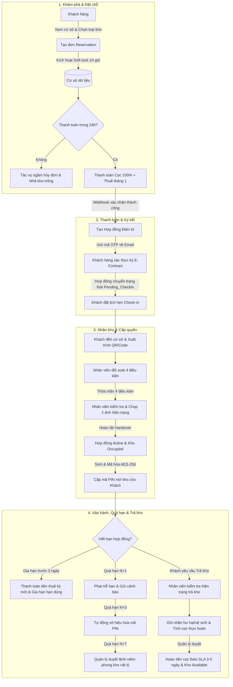
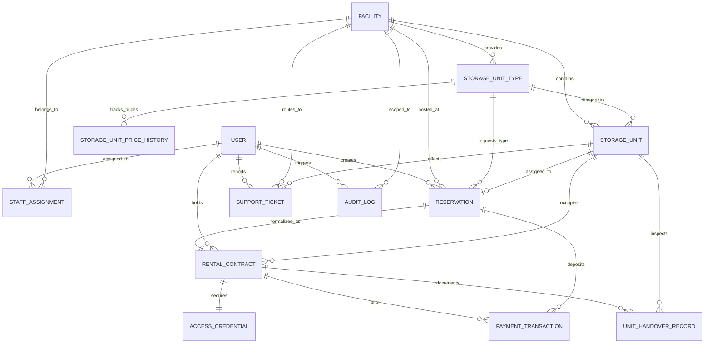

# Software Development Blueprint: Boxora - Self-Storage Facility Rental and Management System

**Project Code:** funef21205 (Project ID: 2)  
**System Name:** Hệ thống Quản lý và Cho thuê Cơ sở Kho Tự quản (Boxora)  
**Status:** Approved & Ready for Implementation  
**Version:** 1.0  
**Owner:** Senior Business Analyst (BA Blueprint Agent) & Boxora Team  
**Last updated:** 2026-10-07  
**Source Document:** `srs.txt`  

---

## 1. Executive Summary

- **Business problem:**
  - Quản lý kho tự quản phân tán, thủ công bằng giấy tờ và bảng tính rời rạc khiến việc theo dõi kho trống, kiểm soát thời hạn hợp đồng và tính phí trễ hạn thiếu chính xác.
  - Rủi ro xung đột đặt chỗ (double-booking) khi nhiều khách hàng cùng chọn một phòng kho hoặc loại kho vào cùng thời điểm.
  - Quy trình bàn giao (handover), kiểm tra trả kho (checkout) và đối soát hoàn trả tiền cọc kéo dài, thiếu hình ảnh/biên bản hiện trạng minh bạch.
  - Quản lý mã khóa cửa vật lý/mã PIN lỏng lẻo; khó thu hồi quyền truy cập khi khách hàng phát sinh nợ quá hạn.
  - Thiếu công cụ báo cáo hợp nhất theo cơ sở (Facility Scoping) và toàn hệ thống về tỷ lệ lấp đầy (Occupancy Rate) cùng dòng tiền thực thu.
- **Desired outcome:**
  - Số hóa và tự động hóa toàn bộ vòng đời lưu trữ đa cơ sở: tìm kiếm, đặt chỗ (Soft-lock 24h), thanh toán trực tuyến, hợp đồng điện tử qua OTP, cấp mã PIN số hóa, gia hạn, trả kho và hoàn cọc.
  - Phân quyền chặt chẽ theo vai trò (RBAC) và cô lập phạm vi dữ liệu theo từng cơ sở (Facility Data Isolation) cho nhân viên và quản lý cơ sở.
  - Bảo mật mã PIN mở cửa bằng thuật toán mã hóa đối xứng AES-256-GCM; tự động thu hồi/vô hiệu hóa mã PIN khi hợp đồng hết hạn hoặc nợ quá hạn.
  - Tự động hóa quy trình đối soát giao dịch thanh toán qua Webhook ký điện tử (idempotent webhook); minh bạch hóa khấu trừ và hoàn tiền cọc theo SLA 3–5 ngày làm việc.
- **Success metrics:**
  - **SM-001 (Thời gian check-in/bàn giao):** Rút ngắn thời gian xử lý thủ tục check-in/bàn giao kho xuống dưới 5 phút/lượt.
  - **SM-002 (Tỷ lệ lấp đầy):** Đạt tỷ lệ lấp đầy kho trung bình toàn chuỗi trên 85%.
  - **SM-003 (Tự động hóa nợ & gia hạn):** 100% thông báo nhắc gia hạn (-7d, -3d) và các mốc quá hạn (+1d, +3d, +7d) được kích hoạt tự động qua Scheduler.
  - **SM-004 (Độ chính xác tồn kho):** Giảm 90% lỗi gán trùng phòng kho hoặc giữ chỗ xung đột.
- **Recommended direction:**
  - Xây dựng hệ thống web responsive tập trung theo kiến trúc Modular Monolith dựa trên Java/Spring Boot (Backend API), React/TypeScript (Frontend Web), PostgreSQL (Database), Spring Security + JWT, thanh toán Sandbox có Webhook ký số và thông báo Email/SMS tự động.

---

## 2. Scope

### In scope
1. **Khách hàng khám phá cơ sở & kho (FR-001):** Tìm kiếm cơ sở, danh mục loại kho, kích thước, diện tích, giá niêm yết và số lượng phòng khả dụng theo thời gian thực.
2. **Đặt giữ chỗ trực tuyến (FR-002, FR-004):** Chọn cơ sở, loại kho, ngày bắt đầu và thời hạn thuê (tối thiểu 1 tháng); kích hoạt cơ chế giữ chỗ tạm thời (Soft-lock) 24 giờ.
3. **Thanh toán trực tuyến & Đối soát Webhook (FR-003):** Hỗ trợ thanh toán tiền cọc (100% 1 tháng) và tiền thuê tháng đầu; xử lý Webhook ký số idempotent.
4. **Hợp đồng điện tử & Ký OTP (FR-003, BR-RULE-005):** Khởi tạo hợp đồng thuê điện tử, khóa giá thuê cố định và xác nhận ký qua mã OTP email.
5. **Lịch hẹn check-in & Mã QR (FR-005, FR-006):** Khách đặt lịch hẹn check-in; sinh mã tra cứu/QR; nhân viên quét QR/tra cứu bằng số điện thoại.
6. **Chỉ định phòng kho vật lý (FR-007):** Quản lý hoặc nhân viên cơ sở chỉ định phòng kho vật lý trống phù hợp trước khi khách đến nhận kho.
7. **Nghiệm thu bàn giao & Cấp mã PIN (FR-008):** Đối soát 4 điều kiện tiên quyết, thực hiện checklist 5 điểm, tải 2 ảnh hiện trạng; sinh và mã hóa mã PIN AES-256-GCM.
8. **Quản lý phòng kho đang thuê (FR-009):** Khách hàng theo dõi hợp đồng, mã PIN mở cửa, hóa đơn, thời hạn thuê của các kho đang sử dụng.
9. **Phiếu yêu cầu hỗ trợ sự cố (FR-010, FR-012):** Khách tạo ticket gắn với phòng kho; nhân viên đúng cơ sở tiếp nhận, xử lý và đóng ticket.
10. **Bảng công việc nhân viên cơ sở (FR-011):** Bảng phân công nhiệm vụ hàng ngày (lịch nhận kho, lịch trả kho, ticket sự cố) cho nhân viên trực ca.
11. **Gia hạn hợp đồng trực tuyến (FR-013, FR-014):** Gửi nhắc hạn trước 7 ngày và 3 ngày; khách gia hạn trực tuyến trước hạn tối thiểu 3 ngày theo các chu kỳ 1, 3, 6, 12 tháng.
12. **Xử lý nợ quá hạn đa giai đoạn (FR-017, FR-018):** Scheduler quét nợ lúc 00:00: N+1 cảnh báo phạt; N+3 khóa PIN; N+7 niêm phong kho vật lý; N+30 chuyển pháp lý ngoại tuyến.
13. **Nghiệm thu trả kho & Hoàn cọc (FR-015, FR-016):** Checklist trả kho kèm 2 ảnh, tính phí hư hại/vệ sinh; duyệt hoàn tiền cọc theo SLA 3–5 ngày làm việc.
14. **Quản lý cơ sở, loại kho & chính sách giá (FR-019):** Business Operations Manager cấu hình cơ sở, loại kho, lịch sử giá thuê, tỷ lệ cọc, phí phạt và chính sách thuê.
15. **Báo cáo vận hành & kinh doanh (FR-020):** Báo cáo doanh thu, tỷ lệ lấp đầy, danh sách nợ quá hạn theo cơ sở và toàn hệ thống.
16. **Quản trị người dùng, phân quyền & cơ sở (FR-021):** Quản lý tài khoản, gán vai trò RBAC, phân công phạm vi cơ sở (StaffAssignment).
17. **Nhật ký kiểm toán & An ninh (FR-022):** Lưu vết bất biến (append-only AuditLog) cho toàn bộ thao tác nhạy cảm và theo dõi lịch sử đăng nhập.

### Out of scope (Phase 1 / MVP)
1. Tích hợp trực tiếp phần cứng IoT điều khiển khóa từ xa qua sóng Bluetooth, Zigbee.
2. Dịch vụ vận chuyển, giao nhận hàng hoặc bốc xếp đồ trọn gói của bên thứ ba.
3. Sàn đấu giá trực tuyến hoặc thanh lý tài sản bỏ rơi (quy trình pháp lý thực hiện ngoại tuyến).
4. Tính năng chia sẻ quyền truy cập cho tài khoản phụ (Sub-user access sharing); MVP chỉ cấp quyền cho chủ hợp đồng.
5. Thuật toán tự động phân bổ phòng kho vật lý (MVP áp dụng phân bổ thủ công bởi nhân viên/quản lý có thẩm quyền).

---

## 3. Stakeholders and Users

| ID | Role | Responsibility | Decision/approval |
|---|---|---|---|
| ST-001 | Storage Customer (Khách hàng Thuê kho) | Tìm kiếm kho, đặt giữ chỗ, thanh toán trực tuyến, ký hợp đồng qua OTP, nhận mã PIN, gia hạn, trả kho và gửi hỗ trợ. | Quyết định đặt chỗ, ký hợp đồng, đồng ý biên bản bàn giao và thanh toán các khoản phí. |
| ST-002 | Facility Staff (Nhân viên Cơ sở) | Tiếp đón khách, tra cứu booking QR, đối soát 4 điều kiện check-in, kiểm tra nghiệm thu bàn giao/trả kho, tải ảnh chứng từ, xử lý ticket. | Xác nhận biên bản bàn giao, ghi nhận hiện trạng hư hại và ghi nhận phí phạt khấu trừ cọc. |
| ST-003 | Facility Manager (Quản lý Cơ sở Kho) | Quản lý sơ đồ phòng kho cơ sở, chỉ định phòng, duyệt niêm phong kho quá hạn, phân công ca trực nhân viên, duyệt đề xuất hoàn cọc. | Quyết định trạng thái kho vật lý, duyệt niêm phong kho nợ và xác nhận hoàn tiền cọc cơ sở. |
| ST-004 | Business Operations Manager (Quản lý Vận hành DN) | Quản lý chuỗi cơ sở, danh mục loại kho, cấu hình chính sách giá, chính sách cọc, phí phạt và theo dõi doanh thu toàn hệ thống. | Quyết định bảng giá, chính sách thuê, khuyến mãi và nghiệm thu chỉ số tài chính chung. |
| ST-005 | System Administrator (Quản trị viên Hệ thống) | Quản lý danh sách tài khoản, vai trò, ma trận phân quyền RBAC, gán phạm vi cơ sở (Facility Scope) và giám sát nhật ký an ninh/kiểm toán. | Quyết định cấp quyền tài khoản, bảo mật hệ thống và giải quyết sự cố kỹ thuật. |
| ST-006 | Payment Gateway (Cổng thanh toán Sandbox) | Tiếp nhận yêu cầu thanh toán, xử lý giao dịch và gửi webhook có chữ ký số để Boxora đối soát. | Xác thực kết quả giao dịch tài chính. |
| ST-007 | System Scheduler (Bộ lập lịch hệ thống) | Tự động thực thi các tác vụ nền: hủy đơn hết hạn 24h, gửi nhắc gia hạn -7d/-3d, quét nợ quá hạn lúc 00:00. | Kích hoạt chuyển trạng thái đơn và hợp đồng tự động. |
| ST-008 | Project Leadership & Engineering Team | Nguyễn Xuân Trường (Lead), Đoàn Hoàng Phúc, Lê Đăng Nguyên, Phạm Duy Khang, Cao Quang Triển. | Phê duyệt thiết kế, kiến trúc, thực thi backend, frontend, kiểm thử và bàn giao sản phẩm. |

---

## 4. Assumptions, Constraints and Open Questions

| ID | Type | Statement | Owner | Status |
|---|---|---|---|---|
| A-001 | Assumption | Khách hàng sở hữu thiết bị có trình duyệt web và hòm thư điện tử hoạt động bình thường để nhận thông báo, mã OTP ký hợp đồng và mã PIN mở cửa. | Lead BA | Confirmed |
| A-002 | Assumption | Nhân viên tại cơ sở được trang bị thiết bị kết nối mạng (PC/Tablet/Smartphone) có camera để quét mã QR và chụp ảnh nghiệm thu hiện trạng kho. | Facility Manager | Confirmed |
| A-003 | Assumption | Các tranh chấp tài sản quá hạn kéo dài trên 30 ngày được xử lý bằng hợp đồng pháp lý ngoại vi, hệ thống chỉ lưu vết trạng thái đóng băng tài nguyên. | Legal / Sponsor | Confirmed |
| C-001 | Constraint | Thời hạn thuê kho tối thiểu cho mỗi hợp đồng là 01 tháng (30 ngày) (BR-RULE-001). | Operations Manager | Confirmed |
| C-002 | Constraint | Tiền đặt cọc cố định bằng 100% tiền thuê 01 tháng (BR-RULE-002). | Operations Manager | Confirmed |
| C-003 | Constraint | Cơ chế giữ chỗ tạm thời (Soft-lock) chỉ có hiệu lực tối đa 24 giờ kể từ thời điểm tạo đơn (BR-RULE-003). | Tech Lead | Confirmed |
| C-004 | Constraint | Bàn giao kho vật lý bắt buộc thỏa mãn đồng thời 4 điều kiện: Đủ tiền cọc + Đủ tiền thuê tháng đầu + Ký hợp đồng điện tử qua OTP + Xác minh CCCD gốc (BR-RULE-005). | Security / Ops | Confirmed |
| C-005 | Constraint | Mã PIN truy cập kho phải được mã hóa hai chiều bằng thuật toán AES-256-GCM ở tầng lưu trữ; tuyệt đối không lưu plain text (BR-RULE-008). | Tech Lead | Confirmed |
| C-006 | Constraint | Nhân viên và Quản lý cơ sở chỉ được phép truy xuất và thao tác dữ liệu thuộc cơ sở được phân công quản lý (Facility Data Isolation). | Tech Lead | Confirmed |
| Q-001 | Open Question | Mức phí phạt vệ sinh và phí mất chìa khóa/thẻ từ mặc định là bao nhiêu nếu khách làm bẩn hoặc mất phụ kiện? (Đề xuất: 200,000 VND - 500,000 VND). | Operations Manager | Confirmed (200k-500k cấu hình qua Policy) |
| Q-002 | Open Question | Khi khách thanh toán trễ hạn, mức phí phạt theo ngày nên tính theo tỷ lệ % tiền thuê tháng hay số tiền cố định? (Đề xuất: 50,000 VND/ngày hoặc 1%/ngày). | Operations Manager | Confirmed (Cấu hình qua Policy) |

---

## 5. Process Analysis

### 5.1 Phân tích hiện trạng (AS-IS) vs Tương lai (TO-BE)

| Step | Current state (AS-IS) | Future state (TO-BE) | Actor/system | Rule or exception |
|---|---|---|---|---|
| 1. Khám phá & Đặt giữ chỗ | Khách gọi điện hoặc đến trực tiếp hỏi kho trống; nhân viên kiểm tra sổ ghi chép, dễ nhầm lẫn diện tích và sót đơn. | Khách xem danh mục cơ sở, kích thước, ảnh trực quan; bấm giữ chỗ tự động kích hoạt cơ chế Soft-lock 24 giờ. | Customer / System | BR-RULE-003: Quá 24 giờ chưa thanh toán, hệ thống tự động giải phóng kho. |
| 2. Thanh toán & Ký hợp đồng | Thu tiền mặt, viết phiếu thu giấy; ký hợp đồng bản cứng nhiều trang, lưu trữ hồ sơ giấy tờ cồng kềnh dễ thất lạc. | Thanh toán trực tuyến (Cọc + Thuê tháng đầu); Webhook tự động đối soát; hợp đồng điện tử ký qua OTP gửi về Email. | Customer / Gateway / System | BR-RULE-002, BR-RULE-011: Khóa giá thuê cố định trong suốt hợp đồng. |
| 3. Check-in & Bàn giao kho | Nhân viên dẫn khách xem kho, bàn giao miệng không có biên bản tình trạng; tranh chấp khi trả kho vì không có ảnh chứng minh. | Khách xuất trình mã QR/Code; nhân viên đối soát đủ 4 điều kiện; hoàn tất checklist 5 điểm kèm chụp tối thiểu 2 ảnh hiện trạng. | Staff / Customer / System | BR-RULE-005: Không đủ 4 điều kiện thì nút bàn giao bị khóa (disabled). |
| 4. Cấp & Quản lý mã ra vào | Giao chìa khóa cơ đơn thuần hoặc đặt mật mã cố định không đổi, nguy cơ bị sao chép hoặc khách cũ quay lại mở trộm. | Hệ thống tự sinh mã PIN ngẫu nhiên, mã hóa AES-256-GCM gửi qua App/Web; tự động thu hồi/khóa PIN khi hợp đồng chấm dứt hoặc nợ. | System / Customer | BR-RULE-008: Mã PIN chỉ có hiệu lực trong thời gian hợp đồng Active. |
| 5. Quản lý gia hạn & Quá hạn | Nhân viên gọi điện nhắc nợ thủ công; khách chây ì không trả tiền nhưng vẫn giữ chìa khóa vào kho bình thường. | Tự động nhắc gia hạn (-7d, -3d); nếu quá hạn kích hoạt quy trình 4 giai đoạn (+1d phạt, +3d khóa PIN, +7d niêm phong vật lý, +30d pháp lý). | Scheduler / Manager / System | BR-RULE-012: Khóa quyền truy cập tự động vào ngày N+3; niêm phong cần Manager duyệt. |
| 6. Nghiệm thu trả kho & Hoàn cọc | Khách trả chìa khóa; kế toán mất nhiều tuần kiểm tra lại phiếu thu cũ để chuyển tiền trả cọc, gây bức xúc cho khách. | Kiểm tra hiện trạng trả kho có ảnh đối chứng; hệ thống tự tính số tiền cọc còn lại sau khi trừ phí; đối soát hoàn tiền tự động theo SLA 3–5 ngày. | Staff / Manager / System | BR-RULE-013, BR-RULE-015: SLA hoàn tiền cọc tối đa 3–5 ngày làm việc. |

### 5.2 Sơ đồ quy trình nghiệp vụ tổng thể (Mermaid Workflow)



---

## 6. Requirements

### 6.1 Business Requirements
| ID | Type | Requirement Statement | Priority | Source | Status |
|---|---|---|---|---|---|
| BR-001 | Business | Hệ thống phải tự động hóa toàn bộ vòng đời lưu trữ từ tìm kiếm, đặt chỗ, thanh toán, bàn giao đến gia hạn, trả kho và hoàn cọc nhằm giảm thiểu thao tác thủ công. | Must | SRS Sec 1.1, Sec 5.2 | Approved |
| BR-002 | Business | Toàn bộ dòng tiền bao gồm tiền cọc, tiền thuê, tiền gia hạn và các khoản phí phát sinh phải được hạch toán minh bạch, đối soát tự động và hoàn trả đúng SLA. | Must | SRS Sec 1.1, Sec 5.2 | Approved |
| BR-003 | Business | Hệ thống phải thực thi triệt để cơ chế cô lập dữ liệu theo phạm vi cơ sở (Facility Scoping) nhằm đảm bảo nhân sự cơ sở này không thể can thiệp vào cơ sở khác. | Must | SRS Sec 1.1, Sec 5.2 | Approved |

### 6.2 Functional Requirements (22 Standardized Requirements)

| ID | Capability | Functional Requirement Statement | Priority | Source | Acceptance Criteria (Gherkin format) |
|---|---|---|---|---|---|
| FR-001 | Catalog & Availability | Hệ thống phải hiển thị danh sách cơ sở, địa chỉ, loại kho, kích thước, diện tích, giá niêm yết và số lượng phòng khả dụng theo thời gian thực cho Khách hàng và Khách vãng lai, để người dùng tra cứu kho phù hợp. | Must | SRS FR-001, 3.3.1 | Given khách truy cập catalog, When chọn cơ sở hoặc lọc kích thước, Then hệ thống trả về danh sách kho phù hợp và số phòng trống trong < 800ms. |
| FR-002 | Reservation Creation | Hệ thống phải cho phép Khách hàng chọn cơ sở, loại kho, ngày bắt đầu và thời hạn thuê (tối thiểu 1 tháng) để tạo đơn đặt giữ chỗ, để khởi tạo giao dịch thuê kho. | Must | SRS FR-002, 3.6.1 | Given loại kho còn phòng trống, When khách chọn thời hạn >= 1 tháng và bấm Đặt chỗ, Then hệ thống tạo Reservation (Pending_Payment) và tính tiền cọc + thuê tháng đầu. |
| FR-003 | Payment Processing | Hệ thống phải hỗ trợ các luồng thanh toán tiền đặt cọc, tiền thuê tháng đầu, phí gia hạn và các khoản phí phát sinh qua cổng thanh toán với đối soát Webhook có chữ ký số, để đảm bảo an toàn giao dịch. | Must | SRS FR-003, 3.7.1, 3.7.2 | Given giao dịch thanh toán thành công, When Webhook gửi chữ ký số hợp lệ, Then hệ thống chuyển Transaction sang Success và xử lý idempotent không trùng tiền. |
| FR-004 | 24-Hour Soft-Lock | Hệ thống phải giữ chỗ tạm thời (Soft-lock) trong đúng 24 giờ cho đơn đặt chỗ chờ thanh toán và tự động giải phóng tồn kho khi hết hạn, để đảm bảo công bằng cho khách hàng khác. | Must | SRS FR-004, 3.6.2 | Given đơn chưa thanh toán sau 24h, When Scheduler quét qua (expires_at < now), Then chuyển trạng thái Reservation sang Expired và tăng lại số phòng trống khả dụng. |
| FR-005 | Check-in Appointment & QR | Hệ thống phải cho phép Khách hàng đặt lịch hẹn ngày giờ đến nhận kho và sinh mã đặt chỗ duy nhất kèm mã QR tra cứu, để chuẩn bị thủ tục tiếp đón tại cơ sở. | Should | SRS FR-005, 3.9.1 | Given hợp đồng đã ký e-contract, When khách chọn khung giờ hẹn, Then hệ thống xác nhận lịch hẹn và sinh mã QR check-in trên giao diện. |
| FR-006 | Reservation QR Lookup | Hệ thống phải cho phép Nhân viên cơ sở tra cứu nhanh đơn đặt chỗ bằng cách quét mã QR hoặc nhập số điện thoại khách hàng, để rút ngắn thời gian làm thủ tục tiếp đón. | Must | SRS FR-006, 3.9.1 | Given khách đưa mã QR hoặc SĐT, When nhân viên quét hoặc tìm kiếm, Then hệ thống hiển thị chi tiết hồ sơ đặt chỗ và trạng thái điều kiện trong < 500ms. |
| FR-007 | Physical Unit Assignment | Hệ thống phải cho phép Nhân viên hoặc Quản lý cơ sở chỉ định phòng kho vật lý cụ thể khớp đúng cơ sở và loại kho cho đơn đặt chỗ, để sẵn sàng bàn giao phòng kho. | Must | SRS FR-007, 3.5.2 | Given phòng kho vật lý đang Available, When nhân viên chỉ định cho đơn booking, Then phòng kho đổi sang Reserved và ngăn chặn gán trùng đồng thời. |
| FR-008 | Handover & Access Issuance | Hệ thống phải đối soát đủ 4 điều kiện tiên quyết, ghi nhận checklist nghiệm thu, ảnh hiện trạng và cấp mã PIN mở cửa, chuyển kho sang Occupied, để kích hoạt hợp đồng thuê. | Must | SRS FR-008, 3.9.2 | Given đủ 4 điều kiện và checklist 5 điểm + 2 ảnh, When nhân viên bấm Hoàn tất bàn giao, Then hợp đồng thành Active, kho thành Occupied và mã PIN được mã hóa AES-256. |
| FR-009 | Rented Units Dashboard | Hệ thống phải cho phép Khách hàng xem danh sách các phòng kho đang thuê, thông tin hợp đồng, ngày hết hạn, mã PIN mở cửa và lịch sử hóa đơn, để chủ động quản lý kho cá nhân. | Must | SRS FR-009, 3.10.1 | Given khách hàng sở hữu hợp đồng Active, When mở trang "Kho của tôi", Then xem được số phòng, mã PIN mở cửa và thời hạn thuê còn lại. |
| FR-010 | Support Ticket Creation | Hệ thống phải cho phép Khách hàng tạo phiếu yêu cầu hỗ trợ sự cố gắn trực tiếp với phòng kho đang thuê, để phản ánh vấn đề tới cơ sở kịp thời. | Must | SRS FR-010, 3.13.1 | Given khách hàng có kho đang thuê gặp sự cố, When điền form tạo ticket và gửi, Then hệ thống tạo Ticket trạng thái Open và định tuyến về đúng cơ sở phụ trách. |
| FR-011 | Staff Daily Task Board | Hệ thống phải cung cấp Bảng công việc hàng ngày tổng hợp lịch nhận kho, lịch trả kho và các phiếu hỗ trợ sự cố trong ngày cho Nhân viên cơ sở, để tổ chức công việc trực ca. | Must | SRS FR-011, 3.1.1 | Given nhân viên đăng nhập ca trực, When mở Dashboard ca trực, Then thấy danh sách phân loại: Lịch nhận kho, Lịch trả kho và Ticket cần xử lý. |
| FR-012 | Support Ticket Resolution | Hệ thống phải cho phép Nhân viên cơ sở tiếp nhận, cập nhật tiến độ xử lý và đóng phiếu yêu cầu hỗ trợ thuộc phạm vi cơ sở của mình, để giải quyết sự cố cho khách hàng. | Must | SRS FR-012, 3.13.2 | Given ticket thuộc cơ sở phân công, When nhân viên cập nhật ghi chú và bấm Giải quyết, Then ticket chuyển Resolved/Closed và thông báo cho khách. |
| FR-013 | Renewal Reminder Automation | Hệ thống phải tự động gửi thông báo qua Email/SMS nhắc khách hàng gia hạn hợp đồng trước ngày hết hạn 7 ngày và 3 ngày, để giảm thiểu rủi ro nợ quá hạn. | Must | SRS FR-013, 3.1.3 | Given hợp đồng còn cách ngày hết hạn 7 hoặc 3 ngày, When Scheduler chạy hàng ngày, Then hệ thống gửi thông báo nhắc hạn và ghi nhận vào NotificationLog. |
| FR-014 | Online Contract Renewal | Hệ thống phải cho phép Khách hàng đủ điều kiện thực hiện gia hạn hợp đồng và thanh toán tiền thuê trực tuyến trước ngày hết hạn tối thiểu 3 ngày, để tiếp tục sử dụng kho. | Must | SRS FR-014, 3.11.1 | Given hợp đồng còn hạn >= 3 ngày, When khách chọn kỳ hạn (1/3/6/12 tháng) và thanh toán, Then ngày kết thúc hợp đồng tự động gia hạn tương ứng. |
| FR-015 | Checkout Inspection & Evidence | Hệ thống phải hỗ trợ Nhân viên cơ sở thực hiện kiểm tra hiện trạng trả kho, tải ít nhất 2 ảnh bằng chứng, ghi nhận chi phí hư hại/vệ sinh và hoàn tất trả kho, để kết thúc hợp đồng. | Must | SRS FR-015, 3.12.1 | Given khách đến trả kho, When nhân viên điền checklist trả kho, tải 2 ảnh và nhập phí khấu trừ, Then hệ thống ghi nhận biên bản nghiệm thu trả kho. |
| FR-016 | Deposit Refund Calculation | Hệ thống phải tự động tính toán số tiền cọc thực hoàn sau khi trừ các khoản phí hư hại/trễ hạn và chuyển Quản lý duyệt theo SLA 3–5 ngày, để đảm bảo minh bạch tài chính. | Must | SRS FR-016, 3.12.2 | Given cọc giữ 3tr và phí phạt 300k, When nghiệm thu trả kho lưu thành công, Then số tiền cọc hoàn tính là 2.7tr và tạo yêu cầu Pending_Accounting_Review. |
| FR-017 | Daily Overdue Scan & PIN Lock | Hệ thống phải tự động quét hợp đồng hết hạn hàng ngày lúc 00:00, tính phí phạt trễ hạn từ N+1 và vô hiệu hóa mã PIN mở cửa từ ngày N+3, để bảo vệ tài sản và chống chây ì. | Must | SRS FR-017, 3.11.2 | Given hợp đồng quá hạn đến ngày N+3, When cron job 00:00 quét qua, Then mã PIN đổi thành Revoked, kho đổi Overdue_Locked và gửi email thông báo. |
| FR-018 | Unit Sealing Workflow | Hệ thống phải cho phép Quản lý cơ sở phê duyệt lệnh niêm phong vật lý kho quá hạn sau ngày N+7 và chuyển hồ sơ sang quy trình xử lý pháp lý ngoại tuyến từ ngày N+30, để thu hồi phòng kho. | Must | SRS FR-018, 3.11.2 | Given kho quá hạn >= 7 ngày, When Quản lý cơ sở bấm duyệt niêm phong, Then kho chuyển trạng thái Sealed, tạo task khóa bảo an và ghi nhận AuditLog. |
| FR-019 | Pricing, Policy & Facility Admin | Hệ thống phải cho phép Business Operations Manager quản lý cơ sở, loại kho, cấu hình lịch sử giá, tỷ lệ cọc, phí phạt và chính sách thuê, để điều hành kinh doanh nhất quán. | Must | SRS FR-019, 3.3.2, 3.4.1, 3.15.1 | Given giá thuê loại kho thay đổi, When Ops Manager lưu giá mới, Then hệ thống lưu bản ghi PriceHistory và chỉ áp dụng cho hợp đồng mới. |
| FR-020 | Operational & Financial Reporting | Hệ thống phải cung cấp báo cáo tỷ lệ lấp đầy kho, doanh thu và các ca nợ quá hạn theo cơ sở (cho Facility Manager) và toàn chuỗi (cho Ops Manager), để theo dõi hiệu quả kinh doanh. | Must | SRS FR-020, 3.16.1, 3.16.2 | Given người dùng có thẩm quyền mở mục Báo cáo, When chọn cơ sở và kỳ báo cáo, Then hệ thống kết xuất biểu đồ và bảng dữ liệu trong < 1.5 giây. |
| FR-021 | Users, Roles & Facility Scoping | Hệ thống phải cho phép System Administrator quản lý người dùng, vai trò, ma trận phân quyền và phân công phạm vi quản lý cơ sở cho nhân sự, để bảo đảm bảo mật hệ thống. | Must | SRS FR-021, 3.2.2, 3.14.1 | Given Admin tạo nhân viên mới, When gán vai trò Staff và liên kết Cơ sở A, Then nhân viên chỉ có thể truy xuất dữ liệu thuộc Cơ sở A. |
| FR-022 | Critical Audit Logging | Hệ thống phải tự động ghi nhận nhật ký kiểm toán bất biến (append-only) cho mọi thao tác đặc quyền (gán kho, duyệt hoàn cọc, khóa PIN, niêm phong, chỉnh giá), để phục vụ giám sát và thanh tra. | Must | SRS FR-022, 3.17.1 | Given thao tác đổi trạng thái kho hoặc duyệt tiền thực thi, When commit thành công, Then 1 bản ghi AuditLog (kèm User, IP, Before/After state) được lưu lại. |

---

## 7. Use Cases and User Stories

### 7.1 Use Cases Overview (UC-001 đến UC-017)
1. **UC-001 (Sign In / Sign Out):** Xác thực người dùng bằng JWT, kiểm tra trạng thái hoạt động và cấp quyền theo vai trò/cơ sở.
2. **UC-002 (View Facilities and Available Units):** Khách hàng/Khách vãng lai xem danh mục cơ sở, loại kho, kích thước và số phòng trống thời gian thực.
3. **UC-003 (Create Reservation):** Khách hàng tạo đơn đặt giữ chỗ với cơ chế giữ chỗ tạm thời (Soft-lock) 24 giờ.
4. **UC-004 (Pay Deposit / Rental):** Khách hàng thanh toán tiền cọc và tiền thuê tháng đầu; cổng thanh toán gọi signed webhook để Boxora đối soát.
5. **UC-005 (Schedule Check-in):** Khách hàng chọn lịch hẹn đến nhận kho và nhận mã QR check-in.
6. **UC-006 (Check-in and Handover):** Nhân viên đối soát 4 điều kiện tiên quyết, hoàn tất checklist 5 điểm kèm 2 ảnh, cấp mã PIN và đổi kho sang Occupied.
7. **UC-007 (Manage Rented Units):** Khách hàng quản lý danh sách phòng kho đang thuê, hợp đồng, mã PIN mở cửa và hóa đơn.
8. **UC-008 (Renew Contract):** Khách hàng gia hạn hợp đồng trực tuyến trước hạn ít nhất 3 ngày theo các chu kỳ 1, 3, 6, 12 tháng.
9. **UC-009 (Checkout and Inspection):** Khách trả kho; nhân viên kiểm tra hiện trạng, chụp 2 ảnh, tính phí hư hại và lập biên bản trả kho.
10. **UC-010 (Overdue Handling):** Tác vụ ngầm quét nợ lúc 00:00 (N+1 phạt, N+3 khóa PIN, N+7 tạo task niêm phong cho Quản lý duyệt).
11. **UC-011 (Support Ticket):** Khách tạo ticket gắn với phòng kho; nhân viên đúng cơ sở tiếp nhận, xử lý và đóng ticket.
12. **UC-012 (Manage Facility/Units):** Quản lý cơ sở và Ops Manager duy trì cơ sở, danh mục loại kho và phòng kho vật lý.
13. **UC-013 (Staff Assignment):** Quản lý cơ sở/Admin phân công nhân viên vào cơ sở để thiết lập phạm vi quyền dữ liệu (Facility Scoping).
14. **UC-014 (Pricing and Policy):** Ops Manager cấu hình giá thuê, lịch sử giá, tỷ lệ cọc, phí phạt trễ hạn và chính sách thuê.
15. **UC-015 (Reports):** Quản lý cơ sở xem báo cáo nội bộ; Ops Manager xem báo cáo doanh thu và tỷ lệ lấp đầy toàn hệ thống.
16. **UC-016 (Users/Roles/Permissions):** System Admin quản lý tài khoản, vai trò và phân quyền.
17. **UC-017 (Audit/Login History):** System Admin kiểm tra nhật ký đăng nhập và nhật ký kiểm toán hệ thống.

---

### 7.2 Detailed User Stories (US-001 đến US-008 with Gherkin AC)

#### US-001: Khách hàng tìm kiếm kho và đặt giữ chỗ trực tuyến
- **Actor:** Storage Customer
- **Statement:** As a customer, I want to search storage by facility, size, and price and reserve a unit with a 24-hour soft-lock, so that I can choose a suitable storage unit online without losing it to others while preparing payment.
- **Priority:** Must-have (P0) | **Traceability:** FR-001, FR-002, FR-004 | **Use Case:** UC-002, UC-003
```gherkin
Scenario: Đặt giữ chỗ kho thành công khi còn phòng trống
  Given Khách hàng đang đăng nhập và chọn Cơ sở "Kho Quận 7", Loại kho "Medium (10m2)"
  And Loại kho này đang có 3 phòng khả dụng
  When Khách hàng chọn ngày bắt đầu thuê là ngày mai, thời hạn 3 tháng và bấm "Đặt giữ chỗ ngay"
  Then Hệ thống tạo đơn Reservation mã "RES-XXXX" với trạng thái "Pending_Payment"
  And Số lượng phòng khả dụng của loại kho giảm đi 1 (còn lại 2)
  And Đơn đặt chỗ có thời hạn hết hạn chính xác 24 giờ kể từ thời điểm tạo
  And Khách hàng được chuyển hướng sang trang thanh toán kèm đồng hồ đếm ngược 24h

Scenario: Từ chối đặt chỗ khi loại kho đã hết sạch phòng trống
  Given Loại kho "Large (20m2)" tại Cơ sở "Kho Bình Thạnh" có 0 phòng khả dụng
  When Khách hàng nhấn nút đặt chỗ
  Then Hệ thống hiển thị thông báo lỗi "Loại kho này hiện đã được thuê hết, vui lòng chọn loại kho khác"
  And Không có đơn đặt chỗ nào được tạo ra
```

#### US-002: Khách hàng thanh toán tiền cọc trực tuyến
- **Actor:** Storage Customer
- **Statement:** As a customer, I want to pay the deposit online, so that my reservation is confirmed and inventory is secured.
- **Priority:** Must-have (P0) | **Traceability:** FR-003, FR-004 | **Use Case:** UC-004
```gherkin
Scenario: Thanh toán tiền cọc thành công qua cổng thanh toán
  Given Khách hàng có đơn đặt chỗ "RES-XXXX" ở trạng thái "Pending_Payment"
  When Khách hàng thực hiện thanh toán tiền cọc qua cổng thanh toán
  And Cổng thanh toán gửi Webhook có chữ ký số hợp lệ xác nhận giao dịch thành công
  Then Hệ thống cập nhật giao dịch sang "Success"
  And Chuyển trạng thái đơn Reservation sang "Confirmed"
  And Khởi tạo Hợp đồng thuê điện tử ở trạng thái "Draft" và gửi mã OTP ký hợp đồng về email
```

#### US-003: Nhân viên tra cứu booking QR và đối soát bàn giao kho
- **Actor:** Facility Staff
- **Statement:** As staff, I want to scan a reservation QR so that I can verify the booking and complete handover quickly.
- **Priority:** Must-have (P0) | **Traceability:** FR-006, FR-008 | **Use Case:** UC-006
```gherkin
Scenario: Bàn giao kho thành công khi thỏa mãn toàn bộ 4 điều kiện
  Given Khách hàng đã nộp đủ tiền cọc, nộp đủ tiền thuê tháng 1 và đã ký E-Contract qua OTP
  And Nhân viên đã đối chiếu CCCD gốc trùng khớp với hồ sơ
  And Nhân viên đã hoàn tất checklist 5 điểm và tải lên đủ 2 bức ảnh chụp cửa và sàn kho
  When Nhân viên bấm nút "Hoàn tất bàn giao"
  Then Trạng thái hợp đồng chuyển sang "Active"
  And Trạng thái phòng kho vật lý chuyển sang "Occupied"
  And Hệ thống sinh mã PIN mở cửa, mã hóa AES-256-GCM và cấp cho khách hàng trên ứng dụng

Scenario: Chặn bàn giao khi chưa tải đủ hình ảnh chứng minh hiện trạng
  Given Đơn hàng đã thỏa mãn điều kiện thanh toán và hợp đồng
  When Nhân viên chỉ tải lên 1 bức ảnh và bấm "Hoàn tất bàn giao"
  Then Hệ thống báo lỗi "Bắt buộc phải tải lên tối thiểu 2 bức ảnh hiện trạng trước khi bàn giao"
  And Trạng thái kho không thay đổi
```

#### US-004: Khách hàng gửi yêu cầu hỗ trợ sự cố gắn với phòng kho
- **Actor:** Storage Customer
- **Statement:** As a customer, I want to submit a support ticket from my rented unit, so that the correct facility staff can handle my issue promptly.
- **Priority:** Must-have (P0) | **Traceability:** FR-010, FR-012 | **Use Case:** UC-011
```gherkin
Scenario: Tạo phiếu hỗ trợ sự cố thành công
  Given Khách hàng đang có hợp đồng Active tại Kho "B-102" thuộc Cơ sở "Kho Thủ Đức"
  When Khách hàng tạo ticket danh mục "Sự cố khóa số", nội dung "Bàn phím khóa chập chờn không nhận số"
  And Bấm "Gửi yêu cầu"
  Then Hệ thống tạo Support Ticket mã "TCK-XXXX" với trạng thái "Open"
  And Phiếu tự động hiển thị trong bảng nhiệm vụ hàng ngày của nhân viên Cơ sở "Kho Thủ Đức"
  And Khách hàng nhận được thông báo tiếp nhận thành công
```

#### US-005: Quản lý cơ sở chỉ định phòng kho vật lý
- **Actor:** Facility Manager
- **Statement:** As a manager, I want to assign an available physical unit so that the customer receives a prepared unit upon check-in.
- **Priority:** Must-have (P0) | **Traceability:** FR-007 | **Use Case:** UC-006, UC-012
```gherkin
Scenario: Chỉ định phòng kho vật lý thành công
  Given Đơn đặt chỗ "RES-XXXX" yêu cầu loại kho "Medium" tại Cơ sở A
  And Phòng kho "A-201" loại "Medium" tại Cơ sở A đang có trạng thái "Available"
  When Quản lý cơ sở chọn phòng "A-201" và bấm "Chỉ định phòng"
  Then Đơn đặt chỗ được liên kết với phòng "A-201"
  And Trạng thái phòng kho "A-201" chuyển sang "Reserved"
  And Hệ thống ghi nhận 1 bản ghi AuditLog
```

#### US-006: Nhân viên nghiệm thu trả kho và tính toán hoàn cọc
- **Actor:** Facility Staff
- **Statement:** As staff, I want to complete a return checklist and record damage fees so that the refund is calculated consistently.
- **Priority:** Must-have (P0) | **Traceability:** FR-015, FR-016 | **Use Case:** UC-009
```gherkin
Scenario: Tính toán hoàn cọc khi có phát sinh chi phí vệ sinh
  Given Khách hàng thuê kho có tiền đặt cọc giữ tại hệ thống là 2,500,000 VND
  When Nhân viên kiểm tra hiện trạng, ghi nhận phòng kho chưa dọn rác và nhập phí vệ sinh 200,000 VND
  And Tải lên 2 ảnh bằng chứng và nhấn "Xác nhận nghiệm thu trả kho"
  Then Hệ thống tính toán số tiền cọc thực hoàn là 2,300,000 VND
  And Tạo yêu cầu hoàn cọc trạng thái "Pending_Accounting_Review"
  And Phòng kho vật lý được chuyển sang trạng thái "Cleaning / Available"
  And Thông báo gửi tới khách hàng cam kết hoàn tiền trong 3 đến 5 ngày làm việc
```

#### US-007: Quản lý vận hành cấu hình bảng giá và chính sách
- **Actor:** Business Operations Manager
- **Statement:** As an operations manager, I want to configure pricing and fees so that business rules are controlled centrally.
- **Priority:** Must-have (P0) | **Traceability:** FR-019 | **Use Case:** UC-014
```gherkin
Scenario: Cập nhật giá thuê mới cho loại kho
  Given Loại kho "Small (5m2)" đang có giá hiện tại là 1,200,000 VND/tháng
  When Ops Manager điều chỉnh giá thành 1,350,000 VND/tháng có hiệu lực từ ngày mai
  Then Hệ thống lưu bản ghi mới vào StorageUnitPriceHistory
  And Các đơn đặt chỗ mới tạo từ ngày mai sẽ áp dụng đơn giá 1,350,000 VND
  And Toàn bộ hợp đồng Active hiện tại vẫn giữ nguyên mức phí thuê cố định đã ký
```

#### US-008: Quản trị viên phân quyền người dùng và phạm vi cơ sở
- **Actor:** System Administrator
- **Statement:** As an administrator, I want to assign users to roles and facilities so that access is limited to authorized scope.
- **Priority:** Must-have (P0) | **Traceability:** FR-021 | **Use Case:** UC-013, UC-016
```gherkin
Scenario: Phân công nhân viên vào cơ sở kho
  Given Tài khoản người dùng "staff_nguyen" có vai trò "Facility Staff"
  When Admin phân công nhân viên này vào "Cơ sở Kho Quận 7"
  Then Bản ghi StaffAssignment được lưu với trạng thái "Active"
  And Khi nhân viên đăng nhập, hệ thống chỉ cho phép truy xuất dữ liệu thuộc "Cơ sở Kho Quận 7"
  And Mọi truy cập vào các cơ sở khác đều bị chặn với mã lỗi 403 Forbidden
```

---

## 8. Data Model

### 8.1 Entity Catalogue (14 Core Entities)

| Entity | Primary Key | Key Fields | Relationships & Cardinality | Lifecycle / Status | Data Classification | Owner |
|---|---|---|---|---|---|---|
| User | id (UUID) | email, phone, password_hash, full_name, role, status, created_at | 1 - N với StaffAssignment, Reservation, RentalContract | Active, Inactive, Locked | Confidential (PII) | System Admin |
| Facility | id (UUID) | code, name, address, city, phone, manager_id, status | 1 - N với StorageUnitType, StorageUnit, StaffAssignment | Active, Maintenance, Inactive | Public | Operations Manager |
| StorageUnitType | id (UUID) | facility_id, name, dimensions, area, base_price_monthly, deposit_rate | N - 1 với Facility; 1 - N với StorageUnit, PriceHistory | Active, Inactive | Public | Operations Manager |
| StorageUnitPriceHistory | id (UUID) | unit_type_id, price, effective_from, effective_to | N - 1 với StorageUnitType | Historical | Internal | Operations Manager |
| StorageUnit | id (UUID) | facility_id, unit_type_id, unit_number, floor, status | N - 1 với Facility; N - 1 với UnitType; 1 - N với RentalContract | Available, Reserved, Occupied, Overdue_Locked, Maintenance | Internal | Facility Manager |
| StaffAssignment | id (UUID) | user_id, facility_id, assigned_role, start_date, end_date, status | N - 1 với User; N - 1 với Facility | Active, Ended | Internal | Facility Manager / Admin |
| Reservation | id (UUID) | reservation_code, customer_id, facility_id, unit_type_id, assigned_unit_id, start_date, duration_months, deposit_amount, status, expires_at | N - 1 với User; N - 1 với Facility; 1 - 1 với RentalContract | Pending_Payment, Confirmed, Cancelled, Expired | Confidential | Customer / Staff |
| RentalContract | id (UUID) | contract_number, reservation_id, customer_id, unit_id, facility_id, start_date, end_date, monthly_fee, deposit_held, status | 1 - 1 với Reservation; N - 1 với StorageUnit; 1 - 1 với AccessCredential | Draft, Pending_Checkin, Active, Overdue, Closed, Terminated | Confidential (Legal) | Customer / Manager |
| AccessCredential | id (UUID) | contract_id, type, encrypted_code, salt, valid_from, valid_to, status | 1 - 1 với RentalContract | Pending, Active, Revoked, Expired | Restricted (Security) | System / Security |
| PaymentTransaction | id (UUID) | transaction_code, contract_id, reservation_id, amount, payment_type, method, gateway_ref, status, created_at | N - 1 với Reservation; N - 1 với RentalContract | Pending, Success, Failed | Confidential (Financial) | Customer / Gateway |
| UnitHandoverRecord | id (UUID) | contract_id, unit_id, staff_id, type, checklist, damage_fee, photos, notes, created_at | N - 1 với RentalContract; N - 1 với StorageUnit | Completed, Audited | Internal | Facility Staff |
| SupportTicket | id (UUID) | ticket_number, customer_id, facility_id, unit_id, category, priority, subject, description, status, assigned_staff_id | N - 1 với User; N - 1 với Facility; N - 1 với StorageUnit | Open, Assigned, In_Progress, Resolved, Closed | Internal | Customer / Staff |
| NotificationLog | id (UUID) | recipient_id, contract_id, channel, type, status, retry_count, sent_at | N - 1 với User | Sent, Failed, Retrying | Internal | System Worker |
| AuditLog | id (UUID) | user_id, facility_id, action, resource, before_state, after_state, ip_address, created_at | N - 1 với User; N - 1 với Facility | Immutable (Append-only) | Restricted (Audit) | System Admin |

### 8.2 Entity Relationship Diagram (Mermaid ERD)



---

## 9. API and Integration Contract

Tất cả các API được bảo vệ bằng cơ chế xác thực JWT Bearer Token qua Header: `Authorization: Bearer <token>`.

| API ID | Method & Path | Purpose | Auth & Roles | Request Schema | Response Schema | Errors & Edge Cases |
|---|---|---|---|---|---|---|
| API-001 | `POST /api/v1/auth/login` | Xác thực đăng nhập, cấp JWT Access Token và Refresh Token. | Public | `{ "email": "string", "password": "string" }` | `{ "access_token": "string", "refresh_token": "string", "role": "string", "facility_ids": [ "UUID" ] }` | 401 Unauthorized, 403 Forbidden (tài khoản khóa) |
| API-002 | `GET /api/v1/facilities` | Lấy danh sách cơ sở kho và số lượng phòng khả dụng. | Public | Query: `city`, `unit_type_id` | `[ { "id": "UUID", "name": "string", "address": "string", "available_units": 15 } ]` | 200 OK, 400 Bad Request |
| API-003 | `GET /api/v1/facilities/{id}/units` | Lấy chi tiết phòng kho và bảng giá theo cơ sở. | Public / Authenticated | Query: `floor`, `status` | `{ "facility_id": "UUID", "units": [ { "id": "UUID", "unit_number": "string", "status": "Available" } ] }` | 404 Not Found, 400 Bad Request |
| API-004 | `POST /api/v1/reservations` | Tạo đơn đặt giữ chỗ kho và kích hoạt cơ chế Soft-lock 24 giờ. | Customer | `{ "facility_id": "UUID", "unit_type_id": "UUID", "start_date": "YYYY-MM-DD", "duration_months": 3 }` | `{ "reservation_id": "UUID", "reservation_code": "string", "expires_at": "ISO", "deposit_amount": 3000000 }` | 409 Conflict (hết phòng), 422 Unprocessable (< 1 tháng) |
| API-005 | `POST /api/v1/payments/create` | Khởi tạo giao dịch thanh toán đặt cọc / tiền thuê. | Customer | `{ "reservation_id": "UUID", "payment_type": "DEPOSIT" }` | `{ "payment_url": "string", "transaction_code": "string" }` | 400 Bad Request (đơn đã thanh toán hoặc đã hủy 24h) |
| API-006 | `POST /api/v1/payments/webhook` | Tiếp nhận và đối soát thanh toán tự động qua Webhook có chữ ký số. | Payment Gateway | Headers: `X-Signature`; Body: `{ "txn_ref": "string", "amount": 3000000, "status": "00" }` | `{ "code": "00", "message": "Success" }` | 400 Bad Request (chữ ký sai), 200 OK (idempotent duplicate) |
| API-007 | `POST /api/v1/contracts/{id}/verify-otp` | Xác thực OTP và hoàn tất ký hợp đồng điện tử. | Customer | Path: `id`; Body: `{ "otp_code": "123456" }` | `{ "contract_id": "UUID", "status": "Pending_Checkin", "signed_at": "ISO" }` | 400 Bad Request (OTP sai/hết hạn), 404 Not Found |
| API-008 | `POST /api/v1/facilities/{fid}/units/assign` | Chỉ định mã phòng kho vật lý cụ thể cho đơn đặt chỗ. | Staff, Facility Manager (Scoped) | `{ "reservation_id": "UUID", "unit_id": "UUID" }` | `{ "reservation_id": "UUID", "unit_number": "string", "status": "Reserved" }` | 403 Forbidden (sai cơ sở), 409 Conflict (kho đã gán) |
| API-009 | `POST /api/v1/handover/complete` | Nghiệm thu bàn giao kho, lưu checklist 5 điểm, 2 ảnh và cấp mã PIN. | Staff (Scoped) | `{ "contract_id": "UUID", "checklist": { ... }, "photo_urls": [ "string" ], "notes": "string" }` | `{ "handover_id": "UUID", "contract_status": "Active", "unit_status": "Occupied" }` | 400 Bad Request (thiếu 4 điều kiện hoặc < 2 ảnh), 403 Forbidden |
| API-010 | `GET /api/v1/customer/units/{id}/pin` | Lấy mã PIN mở cửa giải mã an toàn cho khách hàng. | Customer (Owner) | Path: `id` (contract_id) | `{ "unit_number": "string", "pin_code": "482910", "valid_to": "ISO" }` | 403 Forbidden (không phải chủ hợp đồng hoặc nợ khóa) |
| API-011 | `POST /api/v1/contracts/{id}/renew` | Gia hạn hợp đồng trực tuyến và thanh toán kỳ mới. | Customer | Path: `id`; Body: `{ "renewal_months": 3 }` | `{ "invoice_id": "UUID", "payment_url": "string", "new_end_date": "ISO" }` | 400 Bad Request (dưới 3 ngày hết hạn hoặc nợ quá hạn) |
| API-012 | `POST /api/v1/checkout/inspect` | Nghiệm thu trả kho, ghi nhận chi phí hư hại và tính số tiền hoàn cọc. | Staff (Scoped) | `{ "contract_id": "UUID", "checklist": { ... }, "damage_fee": 200000, "photo_urls": [ "string" ] }` | `{ "refund_estimated_amount": 2800000, "status": "Pending_Review" }` | 400 Bad Request (thiếu ảnh), 403 Forbidden |
| API-013 | `POST /api/v1/refunds/{id}/approve` | Quản lý cơ sở duyệt hoàn tiền cọc chuyển sang kế toán. | Facility Manager (Scoped) | Path: `id`; Body: `{ "approval_note": "string" }` | `{ "status": "Pending_Accounting_Review", "approved_at": "ISO" }` | 403 Forbidden (vượt quyền cơ sở), 404 Not Found |
| API-014 | `POST /api/v1/support-tickets` | Khách tạo phiếu yêu cầu hỗ trợ sự cố gắn với phòng kho. | Customer | `{ "unit_id": "UUID", "category": "LOCK", "subject": "string", "description": "string" }` | `{ "ticket_id": "UUID", "ticket_number": "string", "status": "Open" }` | 400 Bad Request, 403 Forbidden (không sở hữu kho) |
| API-015 | `GET /api/v1/reports/facility-dashboard` | Truy vấn báo cáo tỷ lệ lấp đầy, doanh thu và nợ theo cơ sở. | Facility Manager, Ops Manager | Query: `facility_id`, `from_date`, `to_date` | `{ "occupancy_rate": 88.5, "total_revenue": 450000000, "overdue_count": 2 }` | 403 Forbidden (truy xuất ngoài cơ sở được phân công) |

---

## 10. Non-Functional Requirements (NFR)

### 10.1 External Interfaces (EI)
- **EI-001 (Web Browser):** Giao diện responsive trên Chrome, Edge, Safari; hỗ trợ Desktop và Mobile.
- **EI-002 (Payment Gateway):** Tích hợp cổng thanh toán Sandbox (QR/ATM/Thẻ) với Webhook ký số bảo mật.
- **EI-003 (Email/SMS Service):** Gửi mã OTP xác nhận hợp đồng, nhắc gia hạn và thông báo nợ quá hạn.
- **EI-004 (Identity Verification):** Nhân viên đối chiếu trực tiếp CCCD gốc tại quầy, bảo mật thông tin cá nhân.
- **EI-005 (Image/File Storage):** Lưu trữ hình ảnh hiện trạng bàn giao, trả kho và bằng chứng ticket.
- **EI-006 (Authentication):** JWT access token (15 phút) kết hợp refresh token (7 ngày).

### 10.2 Quality Attributes
| ID | Category | Target / Requirement | Measurement Method | Priority | Owner |
|---|---|---|---|---|---|
| NFR-001 | Performance (API Latency) | Catalog/availability APIs < 800ms p95; các business APIs < 1.5s p95. | Giám sát APM (Prometheus/Actuator) trong điều kiện tải bình thường và cao điểm. | Must | Tech Lead |
| NFR-002 | Availability | Thời gian hoạt động liên tục (uptime) đạt tối thiểu 99.9% cho dịch vụ 24/7. | Đánh giá uptime hàng tháng qua healthcheck ping tự động. | Must | DevOps |
| NFR-003 | Security & RBAC | JWT, RBAC phân quyền 5 vai trò, cô lập phạm vi cơ sở (Facility Scoping), mật khẩu băm Bcrypt/Argon2id. | Unit & Integration Test kiểm tra toàn bộ ma trận phân quyền và truy cập chéo cơ sở. | Must | Security Lead |
| NFR-004 | Data Protection | Mã PIN mở cửa mã hóa AES-256-GCM; toàn bộ kết nối qua HTTPS/TLS 1.3; không lưu thông tin thẻ ngân hàng. | Rà soát cơ sở dữ liệu và quét tĩnh SonarQube bảo mật. | Must | Tech Lead |
| NFR-005 | Scalability | Hệ thống chịu tải tối thiểu 50 cơ sở, 20,000 phòng kho và 10,000 giao dịch thanh toán/ngày. | Load testing với k6/JMeter mô phỏng đặt chỗ đồng thời. | Should | DevOps |
| NFR-006 | Auditability | 100% thao tác thay đổi trạng thái nhạy cảm/bảo mật được ghi nhận vào nhật ký kiểm toán bất biến (append-only AuditLog). | Kiểm tra không cho phép lệnh UPDATE/DELETE trên bảng AuditLog và kiểm tra đủ trường dữ liệu. | Must | Lead BA & Tech Lead |
| NFR-007 | Usability / Compatibility | Giao diện web thích ứng (responsive) mượt mà trên desktop và mobile (từ 375px trở lên). | Cross-browser testing trên Chrome, Edge, Safari. | Must | UI/UX & QA |
| NFR-008 | Disaster Recovery | RTO < 2 giờ; RPO < 15 phút đối với các sự cố cơ sở dữ liệu. | Kiểm tra kịch bản phục hồi từ bản sao lưu định kỳ PostgreSQL. | Should | DevOps |

---

## 11. Security, Privacy and Compliance

- **Authentication and Authorization:**
  - Xác thực qua chuỗi JWT Access Token (hạn 15 phút) và Refresh Token (hạn 7 ngày).
  - Phân quyền theo nguyên tắc đặc quyền tối thiểu (Least Privilege). Nhân viên và Quản lý cơ sở chỉ có quyền thao tác trên cơ sở được phân công; Khách hàng chỉ truy xuất hợp đồng và kho do chính mình sở hữu.
- **Sensitive Data & PIN Encryption:**
  - Mã PIN ra vào kho lưu trữ trong cơ sở dữ liệu bắt buộc phải qua mã hóa hai chiều sử dụng thuật toán AES-256-GCM kèm vector khởi tạo ngẫu nhiên (IV). Tuyệt đối không lưu mã PIN dạng văn bản thuần (plain text).
  - Thông tin định danh cá nhân (CCCD, Số điện thoại, Email) được che mặt nạ (masking) khi hiển thị trên các màn hình tra cứu chung.
- **Audit Trail & Immutability:**
  - Lưu vết toàn bộ lịch sử chỉnh sửa giá, phân công nhân sự, thao tác gán kho, phê duyệt hoàn cọc, khóa PIN và niêm phong vào bảng `AuditLog` với đầy đủ `user_id`, `facility_id`, `before_state`, `after_state`, `ip_address` và `created_at`.
  - Cấm xóa cứng (Hard Delete) trên các bảng dữ liệu vận hành chính (`RentalContract`, `StorageUnit`, `PaymentTransaction`); áp dụng xóa mềm (`is_deleted = true`).
- **Payment Security:**
  - Tích hợp cổng thanh toán Sandbox tuân thủ chữ ký số HMAC-SHA512. Mọi kết quả giao dịch chỉ được cập nhật sau khi đối soát thành công chữ ký số từ Webhook của cổng thanh toán; xử lý idempotent chống trùng lặp.

---

## 12. Delivery Plan and Dependencies

| Increment | Scope | Key Deliverables | Dependency | Exit Criteria | Risk |
|---|---|---|---|---|---|
| Sprint 1: Core Foundation & Auth | Khởi tạo cấu trúc dự án, PostgreSQL Schema, Spring Security, JWT và Quản lý người dùng đa cơ sở (FR-021, NFR-003). | Khung dự án Spring Boot, Seed data 5 vai trò, API Auth, phân quyền Facility Scoping. | Thiết lập Repo & DB Local | 100% test cases Auth & Scoping pass. | Chậm trễ chốt ma trận phân quyền cơ sở. |
| Sprint 2: Facility & Unit Catalog | Quản lý chuỗi cơ sở, loại kho, kho vật lý và lịch sử giá thuê (FR-001, FR-019). | API & UI Quản lý cơ sở, sơ đồ mặt bằng kho, bộ lọc tìm kiếm kho trống cho khách. | Hoàn thành Sprint 1 | Hiển thị chính xác số kho trống theo thời gian thực; truy vấn < 800ms. | Sai lệch dữ liệu số lượng kho khả dụng. |
| Sprint 3: Reservation & Soft-Lock | Đặt giữ chỗ, cơ chế Soft-lock 24 giờ và tác vụ ngầm tự động hủy đơn hết hạn (FR-002, FR-004, NFR-002). | API Đặt chỗ, Scheduler quét đơn hết hạn 24h, đồng hồ đếm ngược giữ chỗ trên UI. | Hoàn thành Sprint 2 | Kiểm thử tải không bị trùng kho; nhả kho đúng sau 24h. | Race condition khi nhiều người cùng giữ 1 kho. |
| Sprint 4: Payments & E-Contract | Tích hợp Payment Sandbox, Webhook idempotent, E-Contract và xác thực ký qua OTP Email (FR-003, BR-RULE-005). | Module thanh toán, xử lý Webhook, template hợp đồng điện tử, Mail Service OTP. | Hoàn thành Sprint 3 | Thanh toán đối soát thành công 100%, gửi OTP và ký hợp đồng thành công. | Webhook bị gọi lặp lại (duplicate). |
| Sprint 5: Handover & Access PIN | Chỉ định phòng vật lý, đối soát 4 điều kiện, checklist nghiệm thu, mã hóa mã PIN AES-256 (FR-006, FR-007, FR-008, NFR-004). | Màn hình Check-in nhân viên, form checklist kèm upload 2 ảnh, thuật toán mã hóa PIN AES-256. | Hoàn thành Sprint 4 | Chặn bàn giao khi thiếu điều kiện; mã PIN sinh ngẫu nhiên và giải mã đúng. | Ảnh tải lên quá nặng gây nghẽn kết nối. |
| Sprint 6: Renewal & Overdue Lifecycle | Quản lý kho đang thuê, thông báo nhắc hạn, gia hạn online và quy trình xử lý nợ 4 mốc (FR-009, FR-013, FR-014, FR-017, FR-018). | Màn hình "Kho của tôi", cổng gia hạn tiền thuê, cron job quét nợ lúc 00:00 (N+1, N+3, N+7). | Hoàn thành Sprint 5 | Khóa mã PIN đúng ngày N+3; tự động gửi mail nhắc hạn trước 7 ngày và 3 ngày. | Cron job chạy sót hợp đồng hết hạn. |
| Sprint 7: Checkout & Deposit Refund | Nghiệm thu trả kho, tính phí hư hại, đề xuất hoàn cọc và đối soát SLA kế toán (FR-015, FR-016). | Form kiểm tra trả kho, logic trừ cọc tự động, quy trình duyệt hoàn cọc cho Quản lý. | Hoàn thành Sprint 6 | Số tiền hoàn tính toán chính xác 100%; kho chuyển về Available sau khi duyệt. | Tranh chấp số tiền hư hại với khách hàng. |
| Sprint 8: Tickets, Reports & Audit | Hỗ trợ sự cố, bảng công việc nhân viên, báo cáo doanh thu/lấp đầy và nhật ký Audit (FR-010, FR-011, FR-012, FR-020, FR-022, NFR-006). | Hệ thống Ticket, Daily Task Board, Dashboard báo cáo quản trị, bảng Audit Log bất biến. | Hoàn thành Sprint 7 | Báo cáo tải < 1.5s; lưu vết 100% thao tác nhạy cảm; nghiệm thu bàn giao dự án. | Báo cáo tính toán sai khi dải ngày lớn. |

---

## 13. Traceability Matrix

| Business Goal | Requirements | Use Cases | Main Data / Components | Test Evidence |
|---|---|---|---|---|
| BR-001 – Tự động hóa vòng đời thuê kho | FR-001, FR-002, FR-004 | UC-002, UC-003 | Facility, UnitType, StorageUnit, Reservation | TC-RES-001/002 |
| BR-002 – Minh bạch dòng tiền & cọc | FR-003, FR-014, FR-016 | UC-004, UC-008, UC-009 | PaymentTransaction, RentalContract | TC-PAY-001/002 |
| BR-001 – Rút ngắn thời gian bàn giao | FR-005, FR-006, FR-007, FR-008 | UC-005, UC-006 | HandoverRecord, AccessCredential | TC-CHK-001/002 |
| BR-003 – Cô lập dữ liệu cơ sở | FR-021, FR-022 | UC-013, UC-017 | StaffAssignment, AuditLog | TC-SEC-001/TC-AUD-001 |
| BR-001 – Kiểm soát nợ quá hạn | FR-017, FR-018 | UC-010 | Scheduler, Contract, StorageUnit | TC-OVD-001/002 |
| BR-001 – Hỗ trợ khách hàng & ca trực | FR-009, FR-010, FR-011, FR-012, FR-013 | UC-007, UC-011 | SupportTicket, NotificationLog | TC-TCK-001/TC-NOT-001 |
| BR-001/BR-002 – Điều hành & Báo cáo | FR-019, FR-020 | UC-014, UC-015 | Policy, Pricing, Reports | TC-REP-001 |

---

## 14. Risks and Decisions

### 14.1 Risk Register
| ID | Risk Description | Impact | Likelihood | Owner | Mitigation Strategy | Status |
|---|---|---|---|---|---|---|
| R-001 | Xung đột đặt giữ chỗ kho trống (Race condition): Nhiều khách cùng chọn 1 loại kho vào giây cuối cùng. | High | High | Tech Lead | Áp dụng khóa bi quan (Pessimistic Locking) hoặc Transaction Isolation ở tầng DB khi trừ phòng khả dụng. | Mitigated |
| R-002 | Bất đồng bộ giao dịch thanh toán Webhook: Khách đã trừ tiền ở ngân hàng nhưng Webhook bị rớt mạng hoặc gửi chậm. | High | Medium | Tech Lead | Thiết kế Webhook Idempotent; cung cấp API truy vấn chủ động trạng thái giao dịch đối soát với cổng thanh toán trước khi hủy đơn. | Mitigated |
| R-003 | Rò rỉ mã PIN mở cửa kho: Mã PIN mở cửa bị lộ hoặc nhân viên xem trộm để vào kho của khách. | Critical | Low | Security Lead | Mã hóa bắt buộc bằng AES-256-GCM; chỉ giải mã khi chính chủ hợp đồng yêu cầu xem trên giao diện; lưu vết Audit Log. | Mitigated |
| R-004 | Lọt dữ liệu giữa các cơ sở (Cross-Facility Data Leak): Nhân viên cơ sở A truy xuất dữ liệu kho cơ sở B. | High | Low | Tech Lead | Triển khai Filter / Custom Security Annotation bắt buộc kiểm tra `facility_id` của User Token trên mọi Endpoint nhạy cảm. | Mitigated |
| R-005 | Tranh chấp tiền cọc khi trả kho: Khách không đồng ý với khoản phí trừ do hư hại vật lý. | Medium | High | Operations Manager | Quy định bắt buộc chụp tối thiểu 2 bức ảnh có dấu thời gian (Timestamp) tại lúc nhận kho và lúc trả kho để làm căn cứ đối chứng. | Mitigated |
| R-006 | Áp lực tiến độ Capstone: Thời gian thực hiện hạn chế ảnh hưởng đến độ phủ kiểm thử. | Medium | High | Project Lead | Ưu tiên các yêu cầu P0 Must-have trước, tự động hóa kiểm thử API và E2E cho các luồng cốt lõi. | Mitigated |
| R-007 | Phụ thuộc phần cứng IoT: Khóa thông minh có thể gây rủi ro kỹ thuật nếu tích hợp sớm. | High | Medium | Tech Lead | Loại trừ điều khiển phần cứng trực tiếp khỏi Phase 1; quản lý mã truy cập hoàn toàn bằng phần mềm. | Mitigated |

### 14.2 Decision Log
| ID | Decision Item | Rationale | Alternatives Considered | Status |
|---|---|---|---|---|
| DEC-001 | Gán phòng kho vật lý thủ công bởi Quản lý/Nhân viên cơ sở trước giờ check-in (Manual Assignment). | Đảm bảo tính linh hoạt thực tế tại cơ sở: nhân viên kiểm tra trực tiếp xem phòng có sạch sẽ, đèn/khóa hoạt động tốt trước khi gán cho khách. | Tự động gán số phòng ngẫu nhiên ngay khi khách tạo đơn đặt chỗ trên web. | Approved |
| DEC-002 | Quản lý mã khóa cửa bằng phần mềm (Software-based PIN Management), không tích hợp trực tiếp phần cứng IoT trong Phase 1. | Giảm thiểu độ phức tạp phần cứng, phụ thuộc mạng sóng Bluetooth/Zigbee tại kho và tập trung hoàn thiện trơn tru luồng nghiệp vụ cho thuê. | Tích hợp bo mạch ESP32 và khóa cổng điện tử thông minh ngay trong đợt đầu. | Approved |
| DEC-003 | Áp dụng thời hạn giữ chỗ tạm thời (Soft-lock) cố định đúng 24 giờ cho đơn đặt chỗ chờ thanh toán. | Đảm bảo khách hàng có đủ thời gian thanh toán online hoặc ra ngân hàng chuyển khoản, đồng thời không ngâm giữ tồn kho quá lâu gây thiệt hại cho cơ sở. | Giữ chỗ trong 15 phút hoặc giữ chỗ đến hết ngày. | Approved |
| DEC-004 | Hợp đồng thuê điện tử được xác nhận bằng mã OTP gửi qua email trước khi bàn giao vật lý. | Tối ưu trải nghiệm pháp lý không giấy tờ, chi phí thấp, tính xác thực cao hơn bấm nút thuần túy. | Ký giấy tờ tay tại quầy hoặc chữ ký số USB token. | Approved |

---

## 15. Quality Review

### 15.1 Đánh giá theo Quality Gates
- **Gate 1: Context Ready: PASSED**  
  Làm rõ bối cảnh kinh doanh chuỗi kho tự quản, 5 vai trò người dùng, mã dự án chính thức (funef21205, Project ID: 2) và phạm vi in-scope / out-of-scope. Tách bạch rõ ràng giữa Assumption, Constraint và Open Question.
- **Gate 2: Requirement Ready: PASSED**  
  Toàn bộ 22 Functional Requirements có mã định danh ổn định (FR-001 đến FR-022), mức độ ưu tiên và tiêu chí chấp nhận cụ thể. NFR có đầy đủ chỉ số định lượng đo lường (Latency < 800ms, Uptime 99.9%, mã hóa AES-256).
- **Gate 3: Solution Ready: PASSED**  
  Mô tả chi tiết các luồng chính và luồng ngoại lệ (Use Cases UC-001 đến UC-017, User Stories US-001 đến US-008, sơ đồ quy trình Mermaid). Hoàn thiện mô hình dữ liệu (14 thực thể), API Contract (15 endpoints chuẩn RESTful) và giải pháp an ninh/bảo mật.
- **Gate 4: Delivery Ready: PASSED**  
  Ma trận Traceability bảo đảm 100% mục tiêu nghiệp vụ được ánh xạ tới Requirement, Use Case, API, Thực thể và Bằng chứng kiểm thử. Ma trận rủi ro có phương án giảm thiểu khả thi.
- **Gate 5: GitHub Delivery Complete: PASSED**  
  Cấu trúc các yêu cầu chức năng (FR-001 đến FR-022) và User Stories đã được chuẩn hóa để chuyển đổi thành các Issue/Task trực tiếp trên GitHub Project #2.

### 15.2 Danh sách câu hỏi còn mở (Unresolved Questions)
- Tất cả các câu hỏi mở chính (Q-001, Q-002) đã được chốt phương án xử lý thông qua cơ chế Policy Configuration linh hoạt dành cho Business Operations Manager.